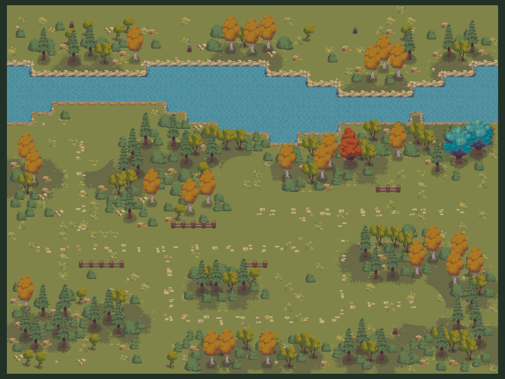
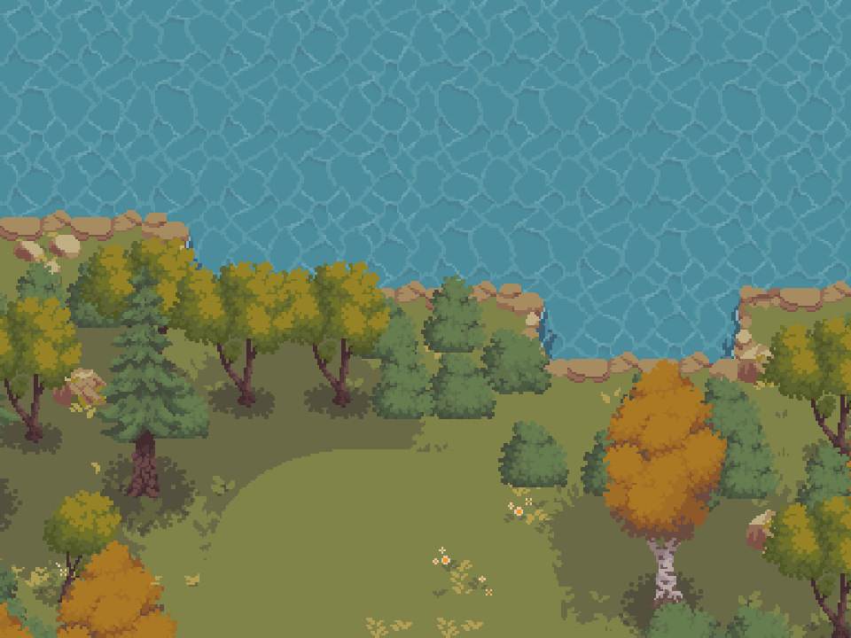
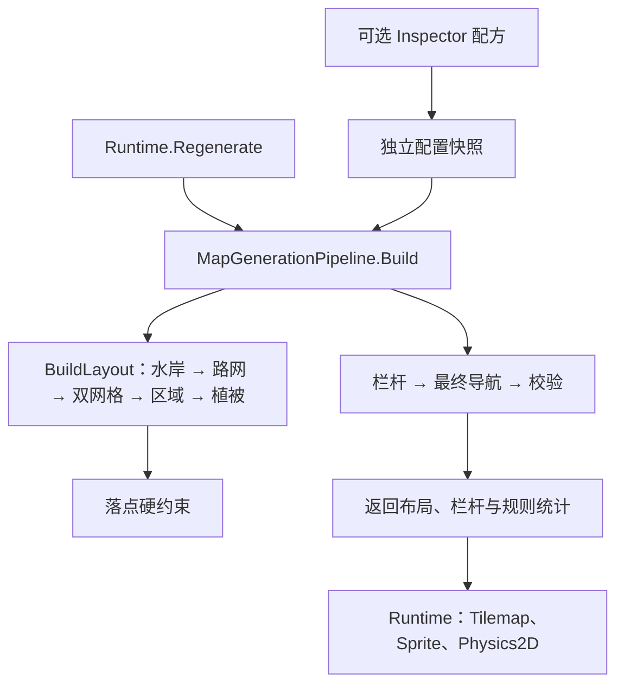

# Unity Client Systems Lab

面向 Unity 客户端实习展示的系统实践项目。当前可运行内容是 **Forgotten Memories 森林随机地图 Demo**：在有限单层地图中生成道路、树群、草土过渡、开放短栏杆和可选河流。



## 快速运行

1. 克隆仓库，在 Unity Hub 中添加**仓库根目录**，使用 **Unity 2022.3.62f3** 打开。
2. 等待 Package Manager 还原 `Packages/manifest.json` 中的依赖并完成脚本编译。
3. 打开 `Assets/ForgottenMemories/PastoralGridV2/Scenes/RiverWoodlandV2.unity`，也可使用菜单 **Forgotten Memories → Pastoral Grid V2 → Open current forest**。
4. 点击 Play。默认展示 seed `202`、林间观景道和宽窄变化的河流。

场景已包含一份可展示的烘焙结果；启动先加载它。运行面板可以输入 seed，点击“重新生成”或“新种子”，切换四种构图、植被密度和河流开关。修改构图、密度或河流后点击“重新生成”应用。

滚轮缩放，鼠标右键或中键拖动；“全图 / 近景”切换观察尺度，“显示角色通行净空”显示导航诊断。当前没有可操控角色或战斗流程。

## 已实现功能

| 模块 | 当前行为 |
| --- | --- |
| 确定性生成 | 相同 seed、配置和生成器版本复现相同布局；运行面板支持更换 seed |
| 有限森林地图 | 48×36 个原生 32px 瓦片，导航步长 16px |
| 四种构图 | 草场路网、林团环线、林间支路、林间观景道；均属于同一森林群系 |
| 主次道路 | 方向感知四邻接 A*，主路、支路、环线、活动空地和通行净空 |
| 草土过渡 | 共享角样本的双网格选片；四角有 16 种理论组合，原素材支持 14 种，生成端整理缺失对角组合 |
| 植被与细节 | 宏观和区域局部 Perlin 调节疏密；树群、树种权重、灌木、石头、铺石和开放短栏杆 |
| 可选河流 | 宽度变化、共享水岸样本、原生六帧水纹、岸边保护距离和水体碰撞 |
| Unity 展示 | Tilemap、独立植物 Sprite、树根与栏杆排序、Physics2D 障碍 |
| 参数与约束 | ScriptableObject 配方快照，五组可组合落点硬约束与首个失败统计 |
| 失败处理 | 无效 seed 或生成失败保留上一张有效地图 |



## 代码结构与调用

```text
Assets/ForgottenMemories/PastoralGridV2/
├── Runtime/
│   ├── Data/          # 请求、配方、地图和栏杆的纯数据
│   ├── Generation/    # 流程编排、稳定噪声初始化、开放短栏杆规划
│   ├── Geometry/      # 道路/空地查询和四向导航
│   ├── Rules/         # 边界、根部净空、水岸、树冠和间距约束
│   ├── Unity/         # 配方资产、原生像素、栏杆素材、根部排序与截图
│   ├── ThirdParty/    # FastNoiseLite 源码、MIT 许可证和来源
│   └── Pastoral*.cs   # 具体地图/河流算法、绘制、运行入口和验收
├── Editor/            # 场景入口与实际 Unity 验收工具
├── Resources/ForestMap/
├── Profiles/ForestDefault.asset
├── Scenes/RiverWoodlandV2.unity
└── Baked/             # 现用场景实际引用的一份烘焙资源
```



核心入口：[运行适配器](Assets/ForgottenMemories/PastoralGridV2/Runtime/PastoralGridV2Runtime.cs)、[纯 C# 流程](Assets/ForgottenMemories/PastoralGridV2/Runtime/Generation/MapGenerationPipeline.cs)、[落点约束](Assets/ForgottenMemories/PastoralGridV2/Runtime/Rules/PlacementConstraints.cs)、[配方](Assets/ForgottenMemories/PastoralGridV2/Runtime/Data/ForestGenerationRecipe.cs)。

生成数据不依赖场景对象。Unity 适配器负责资源加载、对象展示、碰撞和资源释放。坐标以原图左上角为原点，Unity 位置转换为 `(x / 32f, -y / 32f)`；玩家净空检查半径为 9.6px。

## 验证与复现

本次上传前，在独立发布目录中完成了首次导入、脚本编译与现用场景依赖检查。有水/无水 × 两种构图共 4 组生成和真实 Physics2D 验收通过，覆盖 16,511 个通行位置、56,652 次移动扫掠；布局及生成纹理的 SHA256 与已有基线一致。

当前源码在 2026-10-15 的源工程中完成：核心生成 108 张、河流生成 48 张；32 份布局与栏杆结果同重构前基线逐字节一致。实际 Unity Play Mode 验收 12 组通过，覆盖 47,288 个通行位置、80,423 次连续移动扫掠及水动画推进。离线 Python / PowerShell 工具、历史基线和历史报告未随本仓库上传。

仓库包含 Unity 验收代码，可复现运行：

- 停止 Play Mode，确保当前场景已保存，使用菜单 **Forgotten Memories → Pastoral Grid V2 → Run river acceptance**，覆盖有水、无水、密度边界、碰撞、排序与动画。
- 菜单 **Run acceptance** 用于无水森林验收。
- 默认输出到仓库旁的 `../output/ForestCurrentAcceptance/Water` 或 `Dry`；查看 `river_unity_acceptance.json` 或 `unity_acceptance.json` 的 `passed` 字段。重跑前使用空输出目录，避免旧报告被误读。
- 批处理可通过 `-forestAcceptanceOutput` 指定一个新的输出目录。运行参数由临时 Play Mode 实例设置，不保存或重烘焙展示场景。

这些结果只说明当前单层地图的功能与复现行为，不能代表美术方案已经定稿或 Player 帧率、内存已经完成性能验收。

## 当前边界

海拔、连续平台与坡口、不同生态区域及渐变、哥布林/骷髅群落、怪物 AI、无限地图和区块流送尚未接入本运行版。每次开新游戏自动选择 seed、存档和完整 Roguelike 循环也尚未实现。高度研究只存在于仓库外的 PNG 原型。

林下暗草仍有镜像闭合贴片的视觉局限。手工刷瓦片只改变画面，不会反向更新逻辑地图；重新生成会替换 Generated 子树。

背包、红点、存档、网络与资源更新仍属于仓库后续计划，不能按现有设计文档理解为已经实现。项目目前使用 Unity 2022.3.62f3、C#、Tilemap、Physics2D、FastNoiseLite Perlin 和项目内 A*；运行控制面板使用 IMGUI。

## 仓库范围与文档

本次只加入当前 Unity 工程及其运行说明、两张真实 Unity 截图。必要的 `Assets`、`.meta`、`Packages` 和 `ProjectSettings` 一并提交；`Library`、`Temp`、`Logs`、`UserSettings`、构建包、旧场景、PNG 地形试验、Word 报告和本地备份不进入仓库。

- [地图模块说明](Assets/ForgottenMemories/PastoralGridV2/README.md)
- [原生素材拼接与坐标约定](Assets/ForgottenMemories/PastoralGridV2/SOURCE_MATERIALS.md)
- [第三方来源与用途说明](THIRD_PARTY_NOTICES.md)
- [贡献和提交规范](CONTRIBUTING.md)
- [CI 和分支流程](Docs/GitWorkflow.md)
- [后续系统架构规范](Docs/Architecture.md)
- [后续数据模型](Docs/DataModel.md)
- [模块计划](Docs/FeatureScope.md)
